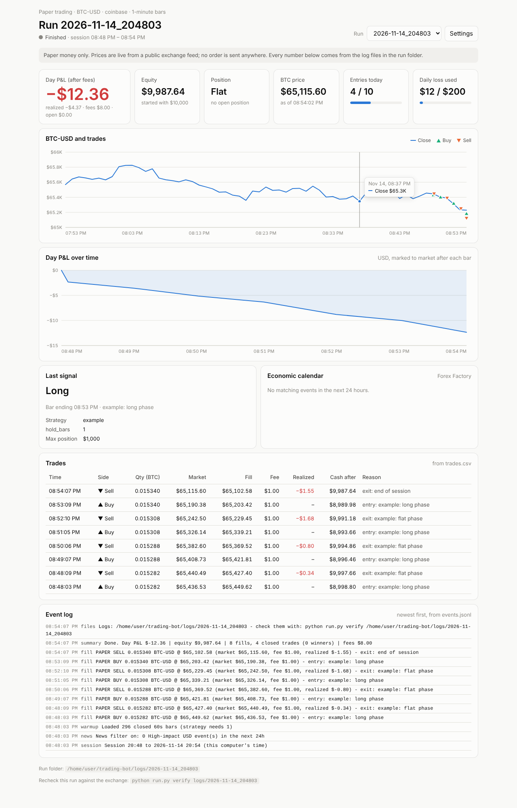

# trading-bot

A Bitcoin **paper-trading** bot you run on your own computer. It pulls live BTC-USD prices from a free public exchange feed, runs your strategy for the day, and shows the fake-money trades and profit on a local dashboard. Every number goes into log files you can recheck against the exchange afterwards.

No account, API key, or money is involved. Nothing is sent to any exchange.



Longer-term futures plans (AMP through Rithmic) are in [PROJECT_SCOPE.md](PROJECT_SCOPE.md).

## Run it

You need **Python 3.10 or newer** ([python.org](https://www.python.org/downloads/); on Windows tick "Add python.exe to PATH").

1. Download the repo (green **Code** button → **Download ZIP**, then unzip it), or `git clone` it.
2. Start the bot:
   - **Windows:** double-click `start.bat`
   - **macOS / Linux:** open a terminal in the folder and run `./start.sh`

The first start sets up a private Python environment in `.venv` (about a minute). Then the bot:

- creates `config/config.yaml` from the example, on first run only
- opens the dashboard at <http://127.0.0.1:8765/>
- trades on paper until `session.end` (23:59 by default), closes any open position, and prints a summary

Press **Ctrl+C** to stop early. The bot closes its paper position and writes the summary first.

Other commands (use `start.bat …` / `./start.sh …`, or `python run.py …` inside the venv):

| Command | What it does |
|---|---|
| `settings` | Open the settings page without trading |
| `run --minutes 30` | A short test run, ignoring the session times |
| `dashboard` | Browse past runs |
| `verify logs/<run>` | Recheck a run's trades and P&L (see below) |
| `check` | Test the data feeds and confirm your private files are git-ignored |
| `backtest --data <file>` | Test a strategy on historical futures data (see [below](#backtest-futures-mnq-and-others)) |

## Your strategy stays private

| What | Where | In git? |
|---|---|---|
| Your settings and strategy parameters | `config/config.yaml` | No, git-ignored |
| Your own strategy code | `src/strategy/private/` or any folder outside the repo | No, git-ignored |
| Run logs | `logs/` | No, git-ignored |
| Cached news calendar | `data/` | No, git-ignored |

The dashboard and settings page are served on `127.0.0.1` only, so other devices on your network can't open them. The page loads nothing from the internet. The settings page and `check` both tell you if git would ever pick up your config file.

> **The GitHub repo is public.** Anything committed is visible to everyone. Never put real values in `config/config.example.yaml` or the template.

### Changing the strategy

**Use a built-in strategy and tune it.** In the settings page (or `config/config.yaml`), pick:

- `sma_cross`: long while the fast moving average is above the slow one.
- `rsi_reversion`: buy oversold, sell overbought, exit near the middle.
- `example`: flips every N bars. It's a pipeline test, not a strategy.

These are textbook examples to check the plumbing.

**Write your own.** Copy `src/strategy/private_template.py` to `src/strategy/private/my_strategy.py`. Edit `on_bar`, then pick **custom** in the settings page and enter that path. Its parameters appear in the form automatically. The run log records a SHA-256 of the file, so you can tell which version of your code produced a result.

The strategy only says *what position it wants* (long, flat, or short). The bot handles the orders, and these limits apply whatever the strategy says:

- max position size
- max daily loss: the bot closes out and stops for the day when it's hit
- max entries per day
- no shorting unless enabled
- no new entries on a stale price
- no new entries around high-impact news (optional)
- stop loss and take profit (optional)

## Checking the results

Each run writes a folder like `logs/2026-11-14_090000/`:

| File | Contents |
|---|---|
| `trades.csv` | Every paper fill: time, side, quantity, exchange price used, fill price, fee, realized P&L, cash and position after, reason |
| `bars.csv` | Every candle the strategy saw, as downloaded |
| `equity.csv` | Account value after each bar |
| `events.jsonl` | Every signal, order, refusal, stop, and data error |
| `run.json` | Settings, strategy parameters, strategy-file hash, and code commit for the run |
| `summary.json` | Final P&L, fees, and trade counts |
| `bot.log` | What the terminal printed |

`python run.py verify logs/<run>` rechecks all of it:

- Replays `trades.csv` from the starting cash and confirms every cash and position column and the totals in `summary.json`.
- Confirms each fee and slippage figure from the configured rates, and that the risk limits held.
- Downloads the exchange's 1-minute candles again and confirms that each fill's price was really trading at that minute.
- Confirms `bars.csv` matches the exchange's candles.

The CSVs open in Excel or Google Sheets if you want to check by hand.

**How paper fills work:** when the strategy changes its target, the bot fetches the latest exchange price and fills there, worsened by `slippage_bps`, then charges `fee_bps`. Retail taker fees are often 0.25%–1.2% per fill, so set `fee_bps` to what you'd really pay. The default of 10 (0.10%) flatters results.

## Backtest futures (MNQ and others)

Test a strategy on historical CME futures data before trading it. This works offline from a [Databento](https://databento.com/) download; nothing is fetched.

```bash
python run.py backtest --data path/to/GLBX-20261115-XXXXXXXXXX.zip
python run.py backtest --data ... --strategy rsi_reversion --params period=10,oversold=25 --bar-seconds 300
python run.py backtest --data ... --strategy-file src/strategy/private/my_strategy.py
python run.py verify logs/backtests/<run>
```

**Getting data:** request OHLCV in **CSV** encoding (not DBN) from the `GLBX.MDP3` dataset. A parent symbol such as `MNQ.FUT` with `ohlcv-1s` gives every contract month at one-second resolution. Pass the `.zip` exactly as downloaded, the `.csv.zst` inside it, or a plain `.csv`. For long periods, download with the split option set to month and pass all the files, or the folder holding them (`--data data/mnq-2026/`); they are read in date order as one dataset, and files that overlap are refused. Keep data files in `data/` or anywhere outside the repo; `data/` is git-ignored.

**Settings** are in `config/backtest.yaml`, created from `config/backtest.example.yaml` on first use and git-ignored. They cover session hours and time zone (default 09:30–15:55 New York), contracts per entry, commission per contract per side, slippage in ticks, stop and target in points, and the per-session risk limits. Command-line options override the file for one run.

**How the replay works:**

- **One contract at a time.** For each CME trade date (17:00–16:00 Chicago), it trades the outright that had the most volume the day before, so the choice uses no future information. Calendar spreads are skipped. On a roll, any position is closed and indicators restart on the new contract. Use `--contract MNQZ6` to force one.
- **Fills come after the decision.** The strategy sees closed bars, and its decision fills at the open of the next traded second, never at a price it already saw. Market and stop fills are `slippage_ticks` worse; targets fill at their price. By default a target needs price to trade one tick through it (`exits.target_fill: through`).
- **Stops and targets** are checked second by second. If one second reaches both, the stop is assumed to come first.
- **Sessions:** indicators see every bar, including overnight, but entries only happen inside the session. Positions close at the session end unless `flatten_at_end` is off. The daily loss limit, trade count and kill switch reset each session.
- **Contract specs** are built in for MNQ, NQ, MES, ES, M2K, RTY, MYM, YM, MGC, GC, MCL and CL; set `instrument` for anything else.

Each backtest writes `trades.csv`, `round_trips.csv`, `daily.csv`, `equity.csv`, `events.jsonl`, `run.json` and `summary.json` to `logs/backtests/<run>/`, plus `report.html`, a page with the stats, an equity and drawdown chart, and every session and trade. `verify` replays the ledger and checks every fill against the data file: the price really traded in that second, each decision filled at the first print after it, and each fill used the right contract. It then reruns the backtest and confirms the fills are identical.

**Read results with care.** The replay leaves out queue position, partial fills, outages and fee changes. A month of data is a small sample, and a rule tuned on the same data will look better here than it trades. Set `commission_per_contract` to your broker's real all-in rate; the example's 0.62 is a placeholder.

## Data sources

All free and keyless. These are the ones the bot uses:

| Source | Used for | Notes |
|---|---|---|
| [Coinbase Exchange](https://docs.cdp.coinbase.com/exchange/reference/exchangerestapi_getproductcandles) (default) | Live price, candles, verification | US-friendly. About 10 requests/second allowed; the bot uses under 1. Full history, so any past run can be verified. |
| [Kraken](https://docs.kraken.com/api/docs/rest-api/get-ohlc-data) | Same, as an alternative | Only the latest 720 candles, so 1-minute runs older than ~12 hours can't be fully re-verified. |
| [Forex Factory](https://www.forexfactory.com/calendar) weekly export | Pausing entries around economic news | No official API. The bot reads the public weekly JSON export, caches it in `data/`, and refetches at most every 6 hours because the server rate-limits repeat downloads. |

Bitcoin trades around the clock. Pick your hours with `session.start` and `session.end`.

Not used, on purpose:

- **TradingView** has no public data API. Its charts are licensed from exchanges, and its terms forbid scraping. Coinbase's candles are the same exchange data at the source.
- **Rithmic** is a paid futures connection that comes through a broker (AMP). It carries CME futures, including CME Bitcoin futures, but not spot BTC-USD, and it isn't the same thing as TradingView. It's the planned feed for the futures phase in [PROJECT_SCOPE.md](PROJECT_SCOPE.md).

## Development

```bash
python -m unittest discover -s tests -t .
```

The tests run offline. They use real responses recorded from Coinbase, Kraken, and Forex Factory, plus a simulated market for full runs and small generated Databento files for the backtester. CI runs them on Linux and Windows.

The `dashboard/` folder holds the earlier React mock. The working dashboard is `src/web/static/` and needs no Node.js.
